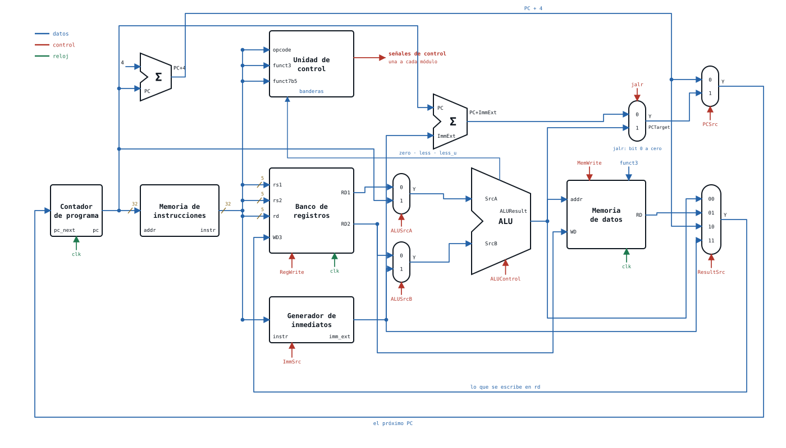

# Taller 2 — Construir las cajas y cablear el procesador

**Arquitectura de Computadores · Universidad Tecnológica de Pereira**

Al final tienen un procesador `RV32I` monociclo que ejecuta un programa de verdad en simulación.
De sus catorce piezas les damos cuatro: la ALU, el banco de registros, el contador de programa y
la memoria de instrucciones. Las otras diez las escriben ustedes.

> `ISA: instruction set architecture` · `RV32I: RISC-V de 32 bits, enteros` ·
> `HDL: hardware description language`

---

## El procesador que vas a cablear



Azul son los datos, rojo el control y verde el reloj. Cada caja es una instancia y cada flecha un
cable de `riscv_monociclo.sv`: son las **catorce instancias** que pide la plantilla.

## Material inicial

| Archivo | Qué es |
|---|---|
| `rtl/riscv_pkg.sv` | las constantes con nombre: `OP_*`, `IMM_*`, `ALU_*`, `RES_*`, `ALUOP_*`, `F3_*` |
| `rtl/pc.sv` | el registro del contador de programa, con `rst` síncrono y `en` |
| `rtl/alu.sv` | la ALU de la semana 5 |
| `rtl/register_file.sv` | el banco de registros de la semana 5 |
| `rtl/instruction_memory.sv` | una palabra por fila, con `$readmemh` |
| `tb/` | los cinco testbenches, auto-comprobables |
| `prog/` | los tres programas, en ensamblador |
| `tools/rvasm.py` | el ensamblador. Nadie escribe un hexadecimal a mano |

Nada de `rtl/` que no sea suyo se toca.

## Lo que construyen

| Archivo | Fase | Qué falta |
|---|---|---|
| `rtl/adder.sv` | 1 | la suma de 32 bits. Se instancia **dos** veces |
| `rtl/mux2.sv` | 1 | el multiplexor de 2 a 1, parametrizable en ancho |
| `rtl/mux4.sv` | 1 | las cuatro ramas del `case` |
| `rtl/imm_gen.sv` | 1 | los cinco formatos de inmediato |
| `rtl/data_memory.sv` | 1 | el corte de la dirección, la lectura con extensión y la escritura por carriles |
| `rtl/control_unit.sv` | 1 | decodificador principal, decodificador de la ALU y `pc_src` |
| `rtl/riscv_monociclo.sv` | 2 | **todo**: los cables, los campos de la instrucción y las catorce instancias |

Cada archivo lleva en su cabecera lo que hace falta saber para escribirlo. Las siete plantillas
compilan tal como se las damos, y sus testbenches fallan: así ven el `FAIL` bajar a cero mientras
avanzan.

## Las órdenes

Cada orden **compila solo lo que necesita**, así que `make imm` funciona aunque el resto de las
plantillas sigan vacías. Van en este orden, del más barato al más caro:

| Orden | Qué compila | Qué prueba |
|---|---|---|
| `make basicos` | `adder.sv` · `mux2.sv` · `mux4.sv` | Que el sumador suma, que el `mux2` elige con `sel` en 32 y en 5 bits, y que el `mux4` cubre las cuatro ramas. **12 comprobaciones** |
| `make imm` | `riscv_pkg.sv` · `imm_gen.sv` | Que los cinco formatos de inmediato salen con el signo extendido donde toca. **10 comprobaciones** |
| `make dmem` | `riscv_pkg.sv` · `data_memory.sv` | Que la dirección de byte cae en la fila de palabra correcta, que `lb`/`lh` extienden signo y `lbu`/`lhu` no, y que un `sb` **no pisa los bytes vecinos**. **16 comprobaciones** |
| `make control` | `riscv_pkg.sv` · `control_unit.sv` | Las nueve filas de la tabla de control, el decodificador de la ALU y `pc_src` en los dos sentidos de un salto. **18 comprobaciones** |
| `make cpu` | **todo**, más los `.hex` | Que el procesador entero ejecuta los tres programas y deja los registros y la memoria como dice la cabecera de cada `.s`. **30 comprobaciones** |
| `make all` | los cinco, en ese orden | Es lo que corre `make` a secas |

Antes de `make cpu`, el Makefile **ensambla los programas**: convierte cada `prog/*.s` en su
`prog/*.hex` con `tools/rvasm.py`. Los `.hex` no se escriben a mano y no se versionan: si cambian
un `.s`, el `.hex` se rehace solo.

```bash
make wave TB=tb_cpu     # abre en GTKWave las ondas de ese testbench
make clean              # borra build/ y los .hex generados
```

Las ondas se abren **cuando el mensaje de fallo no basta**, no antes: el veredicto dice *si* falla,
las ondas dicen *por qué*.

### Lo único que hay que leer

```text
--------------------------------------------------
pruebas: 30    errores: 0
tb_cpu: PASS
--------------------------------------------------
```

Si algo falla, antes del veredicto sale una línea por cada comprobación caída, con lo que se
obtuvo y lo que se esperaba:

```text
  FALLO sb 0x5 respeta vecinos     obtenido=ffffff80  esperado=cafe800d
```

Arreglen **de arriba abajo**: la primera línea suele ser la causa de las de abajo.
